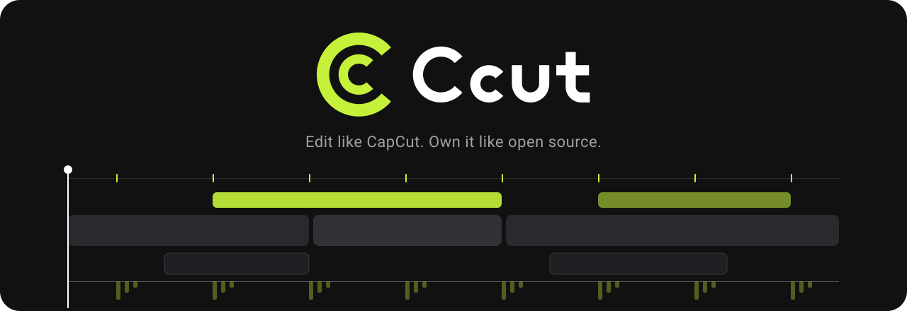
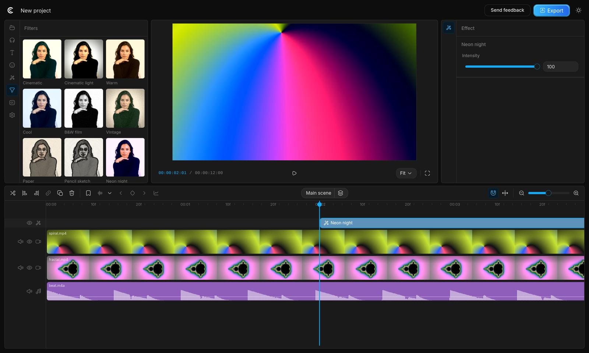
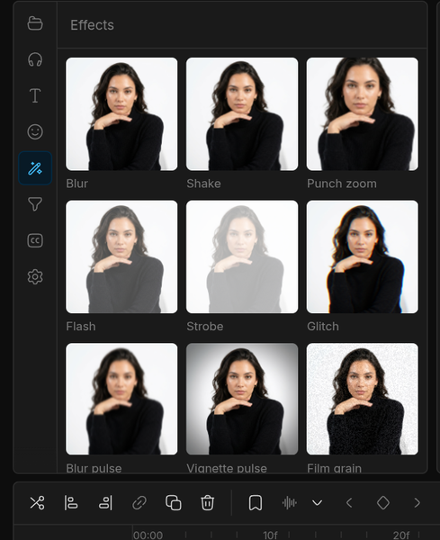
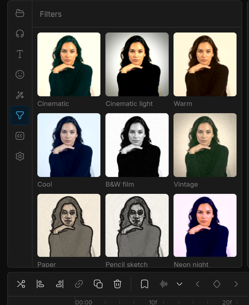
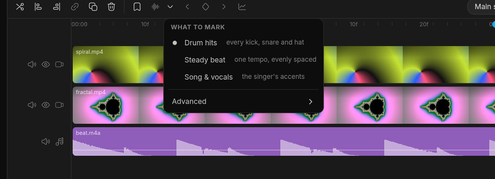
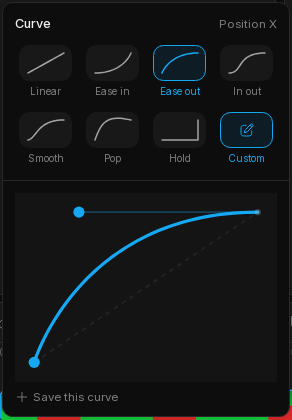
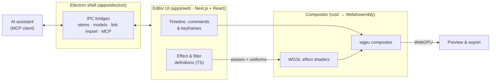

<p align="center">
  
</p>

<p align="center">
  <b>A free, open-source, desktop-first video editor with CapCut-style effects, filters and beat-synced editing.</b><br>
  It renders on your GPU and keeps your footage on your machine.
</p>

<p align="center">
  <a href="LICENSE"></a>
  
  
  
  
  <a href="https://github.com/opencut-app/opencut-classic"></a>
</p>

<p align="center">
  <a href="#-features">Features</a> ·
  <a href="#-getting-started">Getting started</a> ·
  <a href="#-how-it-works">How it works</a> ·
  <a href="#%EF%B8%8F-roadmap">Roadmap</a> ·
  <a href="#%EF%B8%8F-standing-on-the-shoulders-of-opencut">Credits</a>
</p>

<br>

<p align="center">
  
</p>

> [!NOTE]
> **Ccut is built on [OpenCut](https://github.com/opencut-app/opencut-classic).** The timeline, the editor's core and the Rust/WebAssembly compositor all started there. Ccut adds a desktop app and a long list of features on top of that foundation, and [the credits](#%EF%B8%8F-standing-on-the-shoulders-of-opencut) explain why this project would not exist without them.

---

## ✨ Why Ccut

Most "free" editors give you a watermark, a subscription or an upload to someone else's server. Ccut aims for the CapCut workflow you already know (drop in clips, add a look, cut to the beat, export) as a native desktop app, with the source open for anyone to read, change and build.

- **Your files stay with you.** Projects are stored locally. Captions run Whisper locally, and stem separation and smart cutout run as local models. None of them uploads your footage.
- **GPU-rendered preview and export.** A Rust compositor built on `wgpu`, compiled to WebAssembly, draws every frame with WebGPU shaders.
- **Built to be scripted.** A built-in [MCP](https://modelcontextprotocol.io) server lets an AI assistant you choose read and edit your timeline.

## 🎬 Features

<table>
  <tr>
    <td width="50%" valign="top">
      <h3>🎛️ Video effects</h3>
      Eleven effects that move with time: <b>Shake, Punch zoom, Flash, Strobe, Glitch, Blur pulse, Vignette pulse, Film grain, Light leak, Rotate wobble</b> and <b>Blur</b>. Put one on a clip, or on an effect track to cover everything below it. Every tile in the panel loops a live preview when you hover over it.
    </td>
    <td width="50%" valign="top">
      <h3>🎨 Filters</h3>
      Nine one-slider looks: <b>Cinematic, Cinematic light, Warm, Cool, B&amp;W film, Vintage, Paper, Pencil sketch</b> and <b>Neon night</b>. Each runs as GPU passes (colour grade, Sobel-edge sketch, vignette, film grain) and has one <b>Intensity</b> slider, like CapCut.
    </td>
  </tr>
  <tr>
    <td align="center"></td>
    <td align="center"></td>
  </tr>
  <tr>
    <td width="50%" valign="top">
      <h3>🥁 Auto hits: cut to the beat</h3>
      One button finds the hits in your music and marks them on the timeline. Ccut first <b>separates the song into stems</b> (drums, bass, vocals, other) with a local Demucs model, so it can follow the kick and snare, a steady beat grid, or the singer's accents. You can also bring your own stem file.
    </td>
    <td width="50%" valign="top">
      <h3>📈 Keyframes with real curves</h3>
      Animate position, scale, rotation, opacity and effect settings, then shape each segment: <b>Linear, Ease in, Ease out, In-out, Smooth, Pop, Hold</b>, or your own bezier curve, which you can save and reuse. One-click animation tiles add a Shake, Float, Swing, Pan or a volume Fade or Duck.
    </td>
  </tr>
  <tr>
    <td align="center"></td>
    <td align="center"></td>
  </tr>
</table>

### And much more

| | |
|---|---|
| 📌 **Stick to scene** | After Effects-style camera tracking: select a text, sticker or image over a video and press one button. Ccut tracks the shot's features (Lucas-Kanade, RANSAC, homography) so the element moves, scales and rotates with the scene. |
| 🧊 **3D layers** | Place layers in perspective with a virtual camera. |
| ✂️ **Smart cutout & chroma key** | Remove a background with a local U²-Net model (downloaded once and checked against a fixed SHA-256), key out a colour, or paint a mask with the brush. |
| 💬 **Local captions** | Speech-to-text with Whisper in 99 languages, running on your machine. SRT and ASS import. |
| ✍️ **In and out animations** | Fade, Zoom, Pop, slide in from an edge, Typewriter and Word reveal. |
| 🤖 **AI control over MCP** | A token-protected local MCP server with 18 tools (read the project, split, move, set properties, add keyframes, seek, play). Connect Claude Code, Codex or any MCP client. |
| 🔗 **Import from a link** | Paste a link and Ccut downloads and imports the media with `yt-dlp` (desktop app). Only use it for content you have the rights to. |
| 😀 **Stickers, icons & fonts** | 1,500+ Fluent emoji, the Phosphor icon set and 80 bundled font families, all available offline. |
| 🎞️ **Everything a timeline needs** | Multi-track editing, ripple and snapping, split, speed and retime, masks, scenes, bookmarks, and MP4/WebM export. |

## 🚀 Getting started

### Prerequisites

- [Bun](https://bun.sh) **1.2.18** (the version pinned in `package.json`)
- [Node.js](https://nodejs.org) 20 or newer (used by the desktop build scripts)
- *Optional:* Rust with the `wasm32-unknown-unknown` target and [`wasm-pack`](https://rustwasm.github.io/wasm-pack/), but only if you change the compositor. A prebuilt copy ships in [`packages/opencut-wasm`](packages/opencut-wasm).

### Run the editor in your browser

```bash
git clone https://github.com/Msh4i/ccut.git
cd ccut
bun install
cp apps/web/.env.example apps/web/.env.local   # placeholder values are fine for local editing
bun run dev:web
```

Then open **http://localhost:3000**. You need a browser with WebGPU (a recent Chrome, Edge or Brave).

### Build the desktop app

```bash
cd apps/electron
node bundle.js                                  # builds the web app as a standalone server
../../node_modules/.bin/electron-builder --linux AppImage
# or: --win   (NSIS installer + zip)
```

The desktop app adds the features that need your file system or local models: Auto hits stem separation, smart cutout, import from a link and the MCP server.

### Checks

```bash
bun run qa        # TypeScript, unit tests and ESLint
```

## 🧠 How it works



| Folder | What lives there |
|---|---|
| [`apps/web`](apps/web) | The editor: Next.js app, timeline, panels, effects, tracking, captions |
| [`apps/electron`](apps/electron) | The desktop shell: window, IPC, stem separator, model downloads, MCP server, link import |
| [`rust/`](rust) | Compositor, effects, masks and time crates (`wgpu`), built to WebAssembly |
| [`packages/opencut-wasm`](packages/opencut-wasm) | The prebuilt WebAssembly package the editor imports |

Effects and filters are defined in TypeScript as a list of GPU passes. Each pass names a WGSL shader in the Rust crate and gives it uniforms, including the clip's local time, so time-based effects stay frame-exact during export. Contract tests parse both sides so the TypeScript definitions and the Rust shader table cannot drift apart.

## 🗺️ Roadmap

- [x] Time-based video effects with live previews
- [x] Filters with a single Intensity slider
- [x] Stem-aware Auto hits
- [x] Camera tracking ("Stick to scene")
- [ ] Transitions between clips
- [ ] LUT-based filters and a bloom pass
- [ ] Keep effects centred on picture-in-picture clips
- [ ] macOS builds

Ideas and bug reports are welcome in [Issues](https://github.com/Msh4i/ccut/issues).

## ❤️ Standing on the shoulders of OpenCut

**Ccut would not exist without [OpenCut](https://github.com/opencut-app/opencut-classic).**

The OpenCut team and its contributors built what this project grew from: a privacy-first, open-source video editor with a real multi-track timeline, a clean command system, and a Rust/WebAssembly compositor that renders on the GPU. Every feature listed above was built on their architecture, their careful engineering and their decision to share it under the MIT license.

Their commit history is kept here on purpose. Every OpenCut contributor's work is part of this repository, and they deserve the credit for it. If you like Ccut, go and ⭐ **[OpenCut](https://github.com/opencut-app/opencut)** too: they are now working on a full rewrite.

Thank you, OpenCut. 🙏

### Also thanks to

[Demucs](https://github.com/facebookresearch/demucs) (stem separation) · [Whisper](https://github.com/openai/whisper) and [Transformers.js](https://github.com/huggingface/transformers.js) (captions) · [U²-Net](https://github.com/xuebinqin/U-2-Net) and [rembg](https://github.com/danielgatis/rembg) (smart cutout) · [ONNX Runtime](https://onnxruntime.ai) · [wgpu](https://wgpu.rs) · [yt-dlp](https://github.com/yt-dlp/yt-dlp) · [Fluent Emoji](https://github.com/microsoft/fluentui-emoji) · [Phosphor Icons](https://phosphoricons.com) · [Fontsource](https://fontsource.org) · [Next.js](https://nextjs.org) · [Electron](https://www.electronjs.org)

The full list of bundled material, with each license, is in [`THIRD_PARTY_NOTICES.md`](THIRD_PARTY_NOTICES.md).

## 📄 License

Ccut is released under the [MIT License](LICENSE). It keeps OpenCut's copyright notice, as the license requires.

Ccut is an independent project. It is not affiliated with or endorsed by CapCut, ByteDance or the OpenCut team. "CapCut" is mentioned only to describe the editing style.

<p align="center">
  <sub>Made with care by <a href="https://github.com/Msh4i">MsHai</a> · 🇹🇷</sub>
</p>
